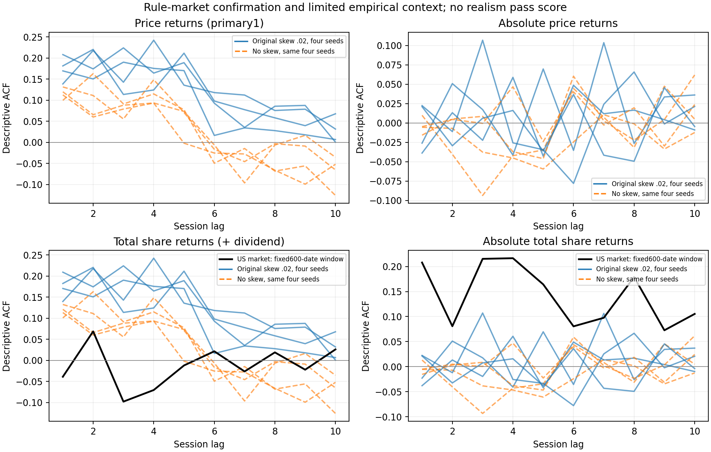

# R039: independent market-background confirmation

Eight600-round rule markets, four fresh seeds; one factor MM inventory skew. Original settings remain unchanged. No LLM API calls. See protocol/report for exact sources, paired financial controls, all blocks, both passive wealth marks and limitations.

Primary no-skew minus original full600 PRICE-return ACF1; zeros and initial-to-first change retained. No pass score, parameter selection or significance test.

|Seed|ACF1 difference|Gap difference pp|Turnover difference pp|MM share difference pp|
|---|---:|---:|---:|---:|
|16253|-0.0499|-2.403|-0.086|0.790|
|17341|-0.0955|1.406|-0.233|3.697|
|18433|-0.0496|-2.032|-0.089|2.398|
|19531|-0.0390|-3.036|0.029|-0.712|

## Empirical context, not calibration

Download status:available. Official source: https://mba.tuck.dartmouth.edu/pages/faculty/ken.french/data_library.html ; construction: https://mba.tuck.dartmouth.edu/pages/faculty/ken.french/Data_Library/f-f_factors.html . Fixed last600 dated returns <=2025-12-31, never selected after viewing. Current-vintage file/hash retained; revisions may change historical observations.

External market return reconstructs(Mkt-RF+RF)/100 before log1p; simulated TOTAL share return uses log((P_t+d_t)/P_prev). These differ from the price-only primary. Broad US portfolio versus one14-agent batch-market stock, different institutions/fundamentals/cashflows; one window is not a universal real-market target. This is not human validation or long-run LLM evidence.

Selected dates:20230811--20251231;600 observations; total-return ACF1=-0.0387,absolute-total-return ACF1=0.2079.

Full600 and three200-session blocks expose changing activity/dependence/cash and MM inventory; do not assume stationarity or select a setting by gap alone. Counterpart passive gains cancel; neither profit nor more trading is a realism oracle. Discovery R020 stays separate from these new confirmation seeds. All positive,zero,negative effects retained. A/B/C unchanged and separate.
