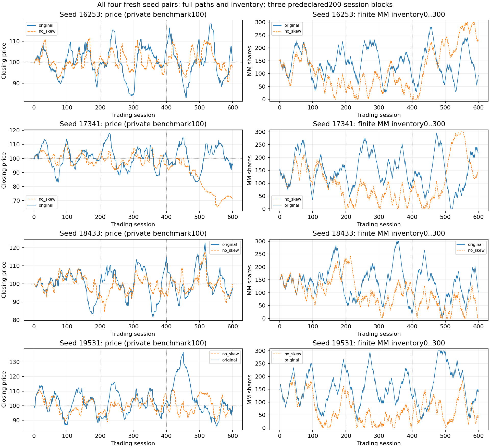

# R039: market-background confirmation and empirical diagnostic

**A useful thesis result is the trade-off, not selection of a winning setting.**
In four fresh simulator scenarios, removing the market maker's inventory-based
quote adjustment lowers full-path one-session return autocorrelation, while
increasing the time it spends at empty/full inventory in every scenario.
Trading activity and pricing gaps are mixed. These are controlled within-model
effects of one setting, not validated real-market or LLM improvements.

## Design and evidence

Eight new600-session quiet **rule-only** markets, four predeclared unused
seeds16253/17341/18433/19531. Each pair changes only MM inventory skew .02->0,
besides run naming; fixed window1,14 slots/MM1/ZI4/F4/M5,160000 cash/1450 shares,
same initial states and exogenous dividend path. Arms alternate execution order
by seed. Source/config/protocol seals precede outcomes. No LLM/API calls,
news/persona/parameter grid, financial-sign stopping or default change.
Primary: paired no-skew-minus-original full600 **price-return ACF at lag1**.
All600 changes include initial-to-first closing price and zero returns.
Three200-session blocks and other diagnostics were secondary before generation.

This independently tests an existing R020 lead; the earlier three-seed discovery
screen and current four-seed confirmation are separate cohorts. Four paired
simulator histories are not eight independent replicates, and the twelve
nested blocks are not twelve independent histories. No significance claim.

|Seed|Original ACF1|No-skew ACF1|Change|Original / no-skew MM boundary sessions %|
|---|---:|---:|---:|---|
|16253|.1814|.1315|-.0499|0.000 / 4.833|
|17341|.2082|.1127|-.0955|1.000 / 5.167|
|18433|.1696|.1200|-.0496|.833 / 2.667|
|19531|.1387|.0997|-.0390|1.667 / 5.167|

ACF here describes how adjacent price changes move together; it is not a
direct profitability or market-efficiency test. Boundaries mean the actual
post-auction MM holdings equal0 or300, not a quote failure or insolvency.

Across four seeds, mean price ACF1 .1745->.1160; mean boundary fraction
.875%->4.458%; mean turnover1.311%->1.216% of shares/session. Turnover falls
in3/4 pairs, but rises in19531. MM union-trade share44.697%->46.240%, higher
in3/4 pairs. Smaller dependence does not automatically imply better liquidity.

Mean internal-benchmark gap6.394%->4.878%, but17341 worsens6.304%->7.710%.
Its no-skew gap is3.272%,3.537%,16.321% in successive200-session blocks;
the original last block is7.233%. No-skew price reaches65.2 and ends70.9
against the private100 benchmark, whereas original ends95.2. In19531 the
last-block ACF contrast reverses sign despite a negative full-path contrast.
Three of the twelve nested block contrasts have the opposite sign to the
full-path comparisons. Do not select a short early window or the average gap
to hide these exceptions. All four full price/inventory pairs are plotted.

Aggregate cash grows about24.311% over600 sessions and is identical within
each seed pair(up to floating point), as implied by the same total shares/
payouts/interest/zero tax. Cash accumulation and changing holdings make
stationarity an assumption needing investigation, not an established property.
The selected factor cannot be credited with changing aggregate cash supply.
Both wealth marks, all account outcomes and zero-sum passive-relative counterpart
checks remain in report.json. These are conditional same-path passive accounts,
not equilibrium paths with trading removed or evidence of welfare/alpha.

## A first empirical context, with matched return definitions

The official [Kenneth French daily factor file](https://mba.tuck.dartmouth.edu/pages/faculty/ken.french/data_library.html)
was obtained after fixing the window: last600 observed dates <=2025-12-31.
Actual dates2023-08-11--2025-12-31. The snapshot banner identifies the202609
CRSP database; current-vintage historical revisions are part of this snapshot.
Raw ZIP178326bytes, SHA256
96c23b88e651cbfff3740a53f8225e59ee39893371e96385a1d8125ec2cd9c89.
Download/retrieval metadata and all600 chosen dated records are retained.

[Source construction](https://mba.tuck.dartmouth.edu/pages/faculty/ken.french/Data_Library/f-f_factors.html)
defines Mkt-RF as a value-weighted US market return less the risk-free rate.
Use(Mkt-RF+RF)/100 to recover a simple market return, then log1p. This is a
**total return**, so its simulator counterpart is log((P_t+d_t)/P_previous),
including the dividend. It is separate from the primary price-only ACF.
No forward fill, date/asset shopping, dropping observed zero returns or
annualization. The six zero total-return observations in the supplied rounded
factor data stay in the600-date series. Independent parser unit checks cover
the cutoff, units and missing-value sentinels.

|Lag1 total-return diagnostic|Original rules, mean4 seeds|No-skew rules, mean4 seeds|One empirical600-date window|
|---|---:|---:|---:|
|Return ACF|.1754|.1170|-.0387|
|Absolute-return ACF|-.0043|-.0032|.2079|

Full lags1-10 in the root diagnostic figure show why lowering one dependence
statistic is insufficient: this skew adjustment alone does not reproduce the
empirical window's pattern of dependence in return magnitudes. That is a
descriptive discrepancy, not a calibrated realism score or statistical rejection.
There is no human behaviour observation in this dataset. A broad US portfolio
and one small batch-market stock differ in institution, diversification,
fundamental shocks and cashflows; the quiet simulated environment also differs
from historical market conditions. One window does not define a universal
target, identify the cause of every discrepancy, establish volatility-clustering
performance generally or validate any LLM trajectory. No empirical-price/gap
target is available from this factor file.

## What changed for the thesis and what did not

This strengthens the existing **market-background trade-off** candidate with
fresh predeclared scenarios and explicit empirical context. It gives a reason
to carry one background sensitivity into a later leading behavioural result,
rather than presenting that result as independent of market mechanics. It does
not select a new default or justify a larger feature/model sweep. Keep skew.02
as the existing baseline and0 as a tested sensitivity; neither is calibrated.

Execution/opportunity and representation/context/cost remain the other two
candidates. Selectable A/B/C are unchanged, and no reflection efficacy or long
LLM market-statistics claim follows from these rule paths. R038 is separately
stopped after a strict numeric-format failure and has **zero clarified replies**;
this study does not establish that the headline correction has passed.

Audits verify every source/config/raw manifest, canonical ACF calculations,
4800 financial rounds/67200 account states, nonnegative resources,1450 shares
per round, MM inventory0..300 and aggregate cash recurrence. Largest cash
reconstruction error5.82e-11; paired dividend/initial-state and passive cancellation
checks pass. Five offline R039 checks pass. These are methods assurance, not
additional thesis headlines. The frozen primary report/readout/figures are
unchanged; this interpretation and all-seed plots are a separate supplement.
