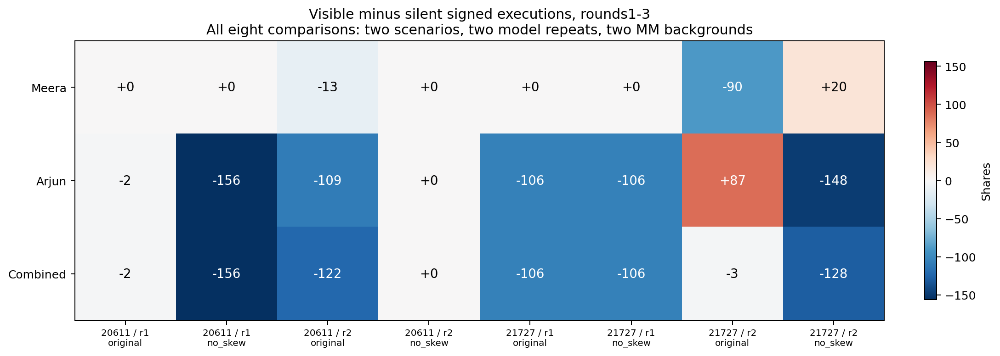

# R041: repeatability, execution and downside-news response

**The pilot shows a directional combined response, with substantial variation
and important aggregation traps.** Visible downside news reduces combined
early net buying in seven of eight planned comparisons; the eighth is zero.
Individual responses can oppose each other, and identical price paths can
conceal different trades and wealth. Market-maker background changes do not
have a consistent effect on response size across these repeats.

This strengthens the existing execution/opportunity thesis candidate under
clearer information and fresh repeated full markets. It does not establish
a universal news effect,human realism,causal persona traits or model superiority.
The eight contrasts nest in **two exogenous scenarios**,two model draws and
two backgrounds; they are not eight independent seed replications or a basis
for an unqualified seven-out-of-eight significance claim.

## What was completed and held constant

All16 live markets completed eight rounds;256/256 normal decisions,128 live
financial rounds,zero missing/uncleared/unattempted slots. Eight actual F/M
rule companions also completed eight rounds with zero requests. Finished
2026-11-04 17:20:39 IST; PID10652 exited. There is no active API job or next
automatic phase.256 successful HTTP/588992 provider-reported tokens/3823311
conservative reservations;zero errors,unknown usage,blocked requests,retries,
JSON repairs,output truncations or reflections. Within384HTTP/6M campaign
and24/450K each arm. R040 is separate:12 HTTP/12187 tokens/143688 reservations;
new tasks together268 HTTP/601179 reported tokens/3966999 reservations.
Reservations are not billed usage or a verified provider quota balance.

Same exact BharatCode qwen-3.8-27b,8192 output cap/low reasoning/temp.3/180s,
memory5/no reflection,10RPM/60000 byte-estimate input TPM. Two fresh seeds
20611/21727,two fresh model repetitions each,MM skew.02 versus0,visible/silent
negative forecast. The true dividend mean changes once at round1,.02->.016;
subsequent payouts vary around that fixed level. Same seed fixes realized
payouts across visibility/background/repeats,not provider sampling. Initial
accounts/personas/first background books match; later feedback differs.
Starting cash10000/shares100 for each target provides both buy and sell
opportunities without artificial buffers. These are new paths,not old replies.

The clarified visible sentence is exactly the R040 candidate: one-time20%
change in expected dividend level starting this session,remaining at that
level in later sessions,actual payments uncertain. R040 independently passed
12/12 explicit readings and36/36 level fields with strict JSON numbers. That
task is not natural trading; its pass does not guarantee each trading rationale
uses the information faithfully. R038 stays stopped,not repaired. No controlled
old/new wording or formatting efficacy estimate follows. Production simulator
defaults and selectable A/B/C remain unchanged; research adapter hides total
recording length and labels the initial dividend honestly as a prior reference.

Protocol/source/config/prompt/gate receipt seals precede market generation:
`../20261104_161605_downside_confirmation_1be3841b`. Revision
0f80f2cfaa6b1059ecbf5c2ded9ffe91640195a6 plus frozen uncommitted source snapshots;
exact normalized configs and actual sent messages retained. Protocol SHA256
698b8bcdfb3230d74430d68e0032f297ef247390d3f206580ece3fa0bc82289f.
Provider sampling is unseeded and backend fingerprint unavailable.

## Frozen primary: visible minus silent executed signed shares, rounds1-3

Negative means less buying and/or more selling. It does not necessarily mean
that many shares were sold. Requested/accepted/filled contrasts all remain in
READOUT.md/report.json; repeated offers are not distinct inventory units.

|Seed|Model repeat|MM background|Meera|Arjun|Combined|
|---|---|---|---:|---:|---:|
|20611|1|original|0|-2|-2|
|20611|1|no skew|0|-156|-156|
|20611|2|original|-13|-109|-122|
|20611|2|no skew|0|0|0|
|21727|1|original|0|-106|-106|
|21727|1|no skew|0|-106|-106|
|21727|2|original|-90|+87|-3|
|21727|2|no skew|+20|-148|-128|

**Decompose execution.** The20611/repeat1/no-skew Arjun contrast -156
consists of67 visible sells versus89 silent buys; it is not156 shares sold.
Visible accepted offers100/68/51 fill32/17/18. The same stock is offered again
when the preceding order only partly fills. At20611/repeat1/original,requested
contrast-1 becomes accepted+15 but executed-2; accepted-order direction alone
would give a different account of this small contrast.

**Combined flow can hide opposing responses.** At21727/repeat2/original,
silent Meera buys40 and visible Meera sells50:net contrast-90. Arjun buys13
in silent versus100 in visible:contrast+87. Combined-3 looks almost unchanged,
although each target's exposure changes substantially. Meera's initial visible
SELL50@100 misses at1 but fills at2; Arjun initially submits BUY60@99.9 and
then raises his bid as price recovers. These are recorded actions,not isolated
risk/loss-aversion effects. His rationale acknowledges the .004 dividend cut
and treats it as a dip-buying opportunity; numerical acknowledgement is not
a guarantee of the preferred response to a forecast.

## Fresh repeats expose provider-response variation

Arjun's eight first visible-news requests have **identical actual message
content and settings**. The first replies are2 BUY,1 SELL,5 HOLD. For example
20611/repeat1/original requests BUY80@99.6,whereas the no-skew counterpart
requests market SELL100. All initial background books within seed match;
with MM initially at its150-share target,the skew adjustment does not alter
the first quotes. The agent has no background-label or seed information in
those delivered messages. Thus that initial action difference cannot be
explained by a different observed market state or active initial skew effect.

The exact shared message hash and all8 first intents/source hashes are in
mechanism_audit.json,using its documented serialization. This is observed
variation in provider outputs on identical sent inputs,not an estimate of
latent beliefs or a controlled temperature effect. Backend weight/fingerprint
pinning is unavailable. It also does not mean a stochastic policy is inherently
unrealistic; variation simply needs to be included in evaluation.

The predeclared secondary no-skew-minus-original combined response contrasts
are -154,+122,0,-125 for20611/r1,20611/r2,21727/r1,21727/r2. There is no uniform
background-response direction here. One can neither attribute the strongest
path solely to the market-maker setting nor declare invariance from the zero.
For20611,original repeats differ -2 versus-122;no-skew differs-156 versus0.
Do not average away those ranges or call these four independent seed pairs.

## Same prices, different trades and wealth

At20611/repeat2/no-skew,the **entire closing-price/dividend/private-benchmark
path** matches between visible and silent. All twelve non-target traders'
account states match at every round. The prices CSV files are not byte-identical:
volume differs because silent Meera buys50 directly from Arjun at92.8 in round5.
That extra target-to-target trade raises round5 volume22->72,while price is
unchanged. No corresponding target-to-target trade occurs in visible.

Visible Meera holds all eight rounds;silent Meera holds150 shares after the
purchase. Her visible-minus-silent passive excess is+580.545 currency units
at auction mark(+2.903pp of initial wealth),+640.545 at benchmark(+3.203pp).
Arjun has the opposite differences. Target combined wealth and both outside
counterpart groups are identical. Price-only evaluation misses the distribution
and exposure effect;this is a specific realised within-target transfer,not
aggregate welfare creation or proof the forecast necessarily caused every
choice. Passive excess0 for a holder is not zero loss on their initial stock.

## Market paths and financial signs remain mixed

Mean whole-path benchmark gaps are smaller with news in6/8 comparisons,
equal in1,worse in1. The worse21727/repeat2/original case has+7.469pp mean-gap
contrast and a+8.7 terminal-price contrast. All prices/counterparts/both marks
remain in the primary report/figure; no attractive subset selected.

At20611/repeat1/no-skew,the visible path first approaches the private80
reference much faster,but later rebounds and ends89.9 versus silent81.2.
Mean gap improves9.391pp,while the terminal absolute gap is larger. Arjun
initially sells67 across the primary window but finishes178 shares versus104
in silent. A three-round response is not his final exposure. Visible passive
excess is still negative:-1.780% auction/-5.641% benchmark,despite being higher
than silent by+5.816/+1.979pp. An incremental improvement is not beating the
holding portfolio. These observations do not identify an externally calibrated
bubble,efficient response or risk-adjusted skill.

Both passive wealth marks use common initial market wealth and hold initial
endowments on each realised payout/price path. All target/MM/other-trader
accounts and aggregate cancellation are retained; zero-tax trading redistributes
wealth rather than proving welfare gains. Equal resources and F/M controls
do not standardize policy sizing or establish intrinsic LLM superiority.

## Thesis placement and limits

This is stronger repeated full-market evidence for the execution/opportunity
candidate,alongside R039's independent long-rule background trade-offs. Keep
representation/context/cost as the third candidate: A/B/C stays selectable,
and this A-only study supplies no new reflection effect. Do not multiply these
eight contrasts into a human-bias sample or claim long-run LLM statistics from
eight rounds. Only truthful downside forecasts at initial time were studied;
there is no established pre-event trend,false-news/trust experiment or effect
for other signs. Older ambiguous-wording studies remain separate and qualified.
Raw reasoning history can carry beliefs past its explicit five-round window;
no simple automatic news-forgetting claim follows.

All source/config/raw/gate seals,32 initial messages,16 first background books,
256 actual-history requests,2688 reconstructed account-round balances and
both passive/counterpart marks pass. Maximum cash reconstruction error2.18e-11;
1450 shares,nonnegative resources and MM0..300 retained. Five driver/five
reading/three readout checks pass offline. Methods assurance is distinct from
the substantive results above. Core analysis artifacts remain unchanged;
supplemental audits and response-figure v2 have separate hashes. v2 fixes only
the first figure's clipped colorbar label; all numbers and v1 remain preserved.

No default,provider,persona or reflection upgrade is selected. The next useful
step is synthesis of the three candidate result stories and a decision whether
the component claim warrants more complete independent comparisons. There is
no automatic additional news/qualification/model/parameter batch here.
