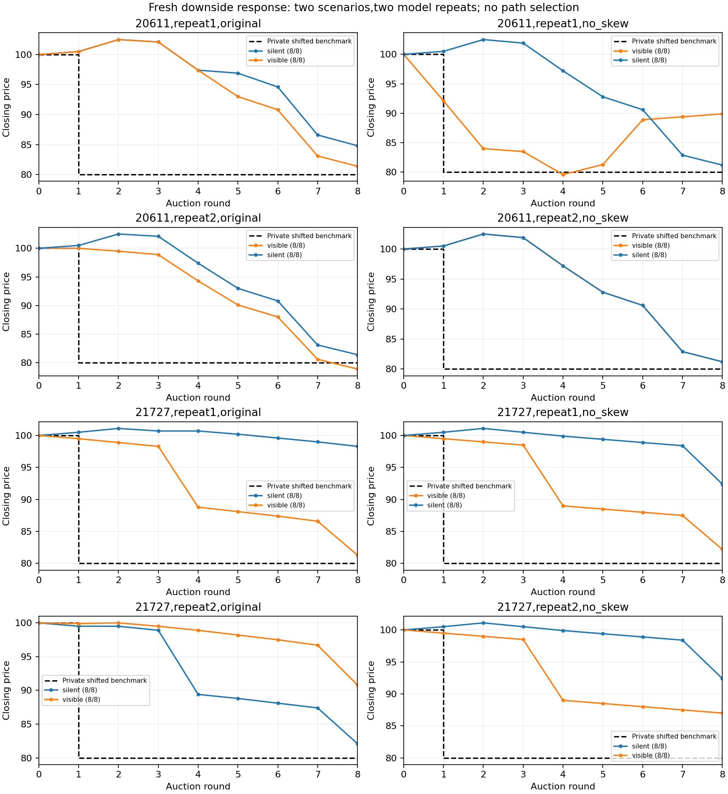

# R041: repeated downside-news / market-background confirmation

Status:completed;16/16 clean full8 paths,16 attempted,0 unattempted. All missing/uncleared/failed prefixes retained.

Two fresh exogenous histories x2 new unseeded model repetitions x2 MM backgrounds xvisible/silent genuine one-time initial dividend-level fall. Repeats nest in two histories,not four independent seeds or sixteen independent treatment replications. Natural initial portfolios/personas/background books match; later feedback/provider draws differ. New clarified candidate passed an EXPLICIT reading check; natural-trading understanding is not guaranteed. No pooling with older ambiguous-wording studies,preferred sign,default selection or human/long-run/trait/model-superiority claim.

## Frozen primary: visible minus silent signed EXECUTED shares, rounds1-3

Triples are requested / accepted / filled contrasts. Positive can mean more buying or less selling. Repeated requests/offers are not distinct shares. Early3 requires three valid cleared rounds in both arms; full8 endpoints require clean complete paths. A later stop does not erase an observed early endpoint; service censoring remains a limitation.

|Seed|Repeat|MM background|Meera requested/accepted/filled|Arjun requested/accepted/filled|Combined filled|
|---|---|---|---|---|---:|
|20611|1|original|0/0/0|-1/15/-2|-2|
|20611|1|no_skew|0/0/0|-363/-340/-156|-156|
|20611|2|original|-90/-90/-13|-314/-284/-109|-122|
|20611|2|no_skew|0/0/0|-17/0/0|0|
|21727|1|original|0/0/0|-315/-293/-106|-106|
|21727|1|no_skew|0/0/0|-274/-260/-106|-106|
|21727|2|original|-140/-140/-90|123/123/87|-3|
|21727|2|no_skew|20/20/20|-387/-371/-148|-128|

## Secondary: no-skew response minus original-background response

Difference of the two descriptive headline contrasts; provider noise and endogenous paths remain. No inferential confidence interval or background-invariant response claim.

|Seed|Repeat|Combined filled response difference|Meera / Arjun difference|
|---|---|---:|---|
|20611|1|-154|0/-154|
|20611|2|122|13/109|
|21727|1|0|0/0|
|21727|2|-125|110/-235|

## Full8 secondary headline contrasts

Excess differences use common initial market wealth; both conditional passive marks. No liquidation,risk-adjusted alpha or equilibrium no-trading counterfactual. Private mean/r benchmark is an internal risk-neutral reference,not human pricing accuracy.

|Seed|Repeat|Background|Close difference|Mean gap difference pp|Meera auction/benchmark pp|Arjun auction/benchmark pp|
|---|---|---|---:|---:|---|---|
|20611|1|original|-3.3999999999999915|-2.281|0.180/0.660|-0.633/-0.517|
|20611|1|no_skew|8.700000000000003|-9.391|0.000/0.000|5.816/1.979|
|20611|2|original|-2.5|-2.859|2.614/2.599|12.487/11.755|
|20611|2|no_skew|0.0|0.000|2.903/3.203|-2.903/-3.203|
|21727|1|original|-17.0|-11.125|0.228/4.620|4.643/14.168|
|21727|1|no_skew|-10.200000000000003|-9.203|0.000/0.000|6.359/10.373|
|21727|2|original|8.700000000000003|7.469|5.673/8.793|-4.230/-7.800|
|21727|2|no_skew|-5.400000000000006|-8.453|-0.602/-0.762|5.925/10.603|

Usage:{'requests_made': 256, 'reserved_tokens': 3823311, 'provider_reported_tokens': 588992, 'unknown_usage_requests': 0, 'blocked_requests': 0}. Audit:{'initial_messages_checked': 32, 'available_first_background_books_checked': 16, 'actual_history_request_checks': 256, 'http_records': 256, 'reserved_only_blocked': 0, 'rule_and_raw_hashes_verified': True, 'errors': [], 'json_repair_attempts': 0}.

All actor per-round limits/headroom/exposure/requested/accepted/buy/sell/gross/net executions,first auction,counterpart groups,baseline evaluations,passive marks,observed prefixes and unattempted slots remain in report.json. Full accounts reconstruct independently from trades/interest/dividends. Eight-round market paths are response studies,not long-run stylized-fact evidence. F/M controls ignore headlines; equal resources do not equate sizing or prove intrinsic LLM superiority. Only truthful downside forecasts studied; no inference about misleading news,all signs or trust calibration. A/B/C/defaults unchanged. See protocol for source/profile/failure seals.
