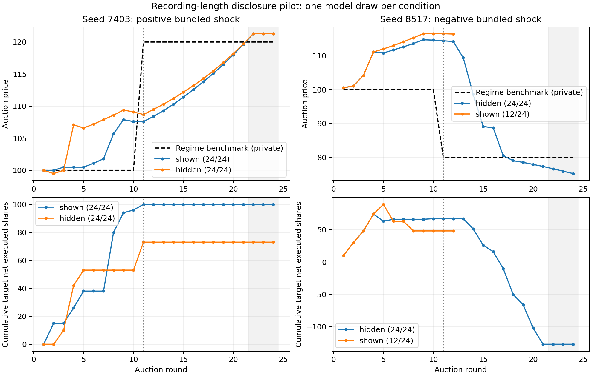

# R032 recording-length disclosure pilot

Status: **stopped**. 3/4 planned markets complete24 rounds. No automatic retry, omitted failed outcome or endpoint substitution. See protocol for frozen endpoints and limits.

Only the first user label Round n/24. versus Round n. changes from round1. Continuing stock, end-of-run valuation, economic rules, personas, Qwen8192/low/temp.3 and common exogenous scenarios remain. Own endogenous paths/model draws differ. Base simple_A_v2 plus horizon_visibility_v1_from_round1 is preserved in each actual request. This is NOT indefinite stochastic stopping or a human replication.

## Frozen primary: last-three-round executed net flow

Buy minus sell, rounds22-24. Combined flow is the sum of two target actors; target-to-target trades cancel in net flow. Partial24-round endpoints are missing. Positive contrast means shown-length targets bought more/sold less; it is not automatically beneficial or more realistic.

|Seed|Shown net shares|Hidden net shares|Shown minus hidden|
|---|---:|---:|---:|
|7403|0|0|0|
|8517|None|0|None|

## Actor outcomes and both terminal marks

Conditional active-minus-passive excess return, percentage points of initial market wealth. Neither terminal mark implies liquidation or risk-adjusted skill. All population counterpart gains/losses and rule companions remain in report.json.

|Seed|Disclosure|Actor|Last3 buys|Last3 sells|Auction excess pp|Benchmark excess pp|
|---|---|---|---:|---:|---:|---:|
|7403|shown|Meera Iyer|0|0|0.27|0.25|
|7403|shown|Arjun Malhotra|0|0|8.35|7.73|
|7403|hidden|Meera Iyer|0|0|-1.68|-1.55|
|7403|hidden|Arjun Malhotra|0|0|7.09|6.49|
|8517|hidden|Meera Iyer|0|0|4.82|4.17|
|8517|hidden|Arjun Malhotra|0|0|-8.00|-10.40|
|8517|shown|Meera Iyer|None|None|missing|missing|
|8517|shown|Arjun Malhotra|None|None|missing|missing|

## Market and execution context

All financial measures below require a clean completed24-round arm. Gap is relative to a private internal regime benchmark, not empirical pricing accuracy. MM volume is full-run union involvement; target volume is post-event union involvement. Their periods/denominators differ.

|Seed|Disclosure|Post gap %|Post target volume %|MM volume %|Last3 price return %|Last3 max drawdown %|
|---|---|---:|---:|---:|---:|---:|
|7403|shown|4.84|1.51|36.66|1.42|0.00|
|7403|hidden|4.42|7.66|41.12|1.34|0.00|
|8517|hidden|13.79|61.20|43.23|-2.72|2.72|
|8517|shown|missing|missing|missing|missing|missing|

Last3 price return is P24/P21-1. Drawdown is the largest peak-to-subsequent-close fall over closes21-24. Both are secondary; neither overrides the frozen primary flow. Exposure/capacity at21 is a consequence of the from-round1 policy treatment, not a matched pre-treatment covariate.

## Cost, failures and limits

171 HTTP attempts; 470131 provider-reported tokens; 2775388 conservative token reservations; 2 unknown-usage requests; 0 blocked. Provider sampling seed/backend fingerprint unavailable. No reflection calls.

Report includes all completed/partial/uncleared orders, source/config/prompt hashes, actual recent-history checks, opportunity before news/last3, requested/accepted/filled quantities, MM/inventory, prices and both marks for all accounts. A missing planned terminal value must not be replaced by the last observed prefix; partial observations remain separately available.

Exploratory two exogenous scenarios, one live model draw each condition; no inferential/general horizon effect or human replication. Number of recording rounds is undisclosed, not indefinite stochastic stopping: end-of-run wording remains. Endogenous pre-event states differ. Unseeded provider sampling, date/order and own-history feedback confound exact repeatability. No selected default, model switch or new A/B/C efficacy claim.

News is a forecast plus actual permanent dividend shift. One seed per direction cannot establish a directional interaction or isolated headline effect. Four rule companions are economic benchmarks, not identical-sized policy controls or independent LLM repetitions. Do not pool this adapter with original-v2 A/B/C as though prompts were identical. No automatic default or broader grid is justified by this pilot alone.
