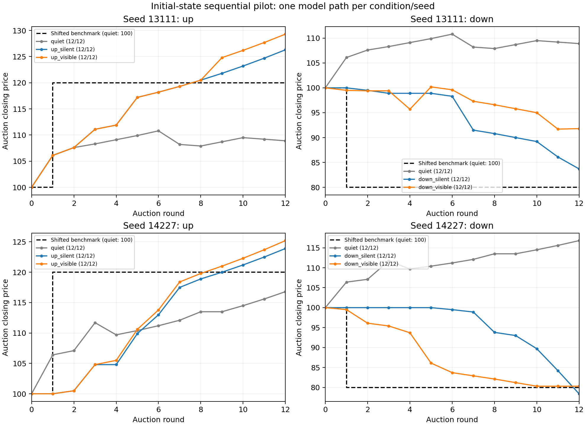

# R036: initial-state sequential headline/economic controls

Status **completed**; 10/10 clean12-round markets, 10 attempted, 0 unattempted. Partial/cancelled choices and unknown costs retained. No failed-path splice/resampling/model switch.

True dividend-mean shifts at INITIAL1, visible/silent within regime have the SAME exogenous payouts and initial accounts/personas/backgrounds. First silent prompts match quiet/up/down; visible first messages differ only headline. Subsequent divergence is part of the treatment/feedback path plus unseeded model draws, not pre-event state differences. Two scenarios, one model path per condition; no inferential/general human/news effect.

Shared research prompt clarifies supplied initial dividend as a PRIOR REFERENCE, not a paid observation in this recording. Hidden episode length/continuing-stock rule common. Production v2/A/B/C/defaults unchanged; no controlled old/new semantic benefit or pooling with older prompt studies.

## Frozen primary: visible minus silent signed executed shares in rounds1-3

Early endpoints are available only when both paths have all3 financial rounds and valid choices. A later technical stop does not erase that predeclared observed endpoint;12-round outcomes remain missing unless clean/full. Do not assume censored paths are representative.

|Seed|Shift|Meera requested / accepted / filled|Arjun requested / accepted / filled|Combined filled|
|---|---|---|---|---:|
|13111|headline_up|50/50/13|13/22/-13|0|
|13111|headline_down|0/0/0|10/10/0|0|
|14227|headline_up|0/0/0|53/38/22|22|
|14227|headline_down|-150/-150/0|-465/-465/-97|-97|

## Secondary full12 headline contrasts

Excess differences in percentage points of common initial market wealth, BOTH conditional passive marks. These are not liquidation, risk-adjusted skill, aggregate welfare or human-realism scores. Gap is a private internal risk-neutral reference, not empirical pricing accuracy.

|Seed|Shift|Terminal price difference|Mean gap difference pp|Meera excess auction / benchmark pp|Arjun excess auction / benchmark pp|
|---|---|---:|---:|---|---|
|13111|headline_up|3.000000000000014|0.833|1.21/1.35|0.56/-0.76|
|13111|headline_down|8.099999999999994|3.771|2.02/0.61|2.70/0.24|
|14227|headline_up|1.2999999999999972|0.042|-0.35/-0.16|3.92/3.21|
|14227|headline_down|1.8999999999999915|-10.323|9.15/8.37|6.18/6.87|

## Delivery and interpretation limits

Usage:{'requests_made': 241, 'reserved_tokens': 3750938, 'provider_reported_tokens': 606498, 'unknown_usage_requests': 1, 'blocked_requests': 0}. All observed-prefix evaluations, target round histories/headroom/order limits/actual fills, volume/MM/inventory, full-lifetime passive marks/counterpart groups, first-auction controls, silent-regime-minus-quiet comparisons and unattempted slots are in report.json. Prefix evaluations are not substituted for missing12-round values.

Only2 exogenous scenarios, one unseeded model path per condition; not10 independent treatment repetitions. Initial event lacks established pre-event trends; later paths include model-sampling/feedback variation. No human validation, universal headline effect, long-run stylized facts or intrinsic LLM superiority. F/M companions are specified equal-slot policies that ignore text. New prompt variant not pooled with old matched-query studies or interpreted as a semantic-before/after improvement. Initial prior is shared, not a disclosed new-regime oracle. A raw reasoning history can carry news beliefs beyond the5-round window.

At-start treatment solves pre-event divergence for this design, but removes established pre-news trend context. Private current mean does not enter initial silent input; first-silent action differences can arise from model sampling. Do not interpret them as reactions to unavailable information.12 rounds cannot validate long-run stylized facts. F/M rules ignore headlines by construction, so their exact negative controls do not prove LLM superiority. Higher/lower benchmark gaps and profits alone do not establish realism. No post-hoc word/parameter/provider/reflective-mode grid is authorized by a preferred sign.
