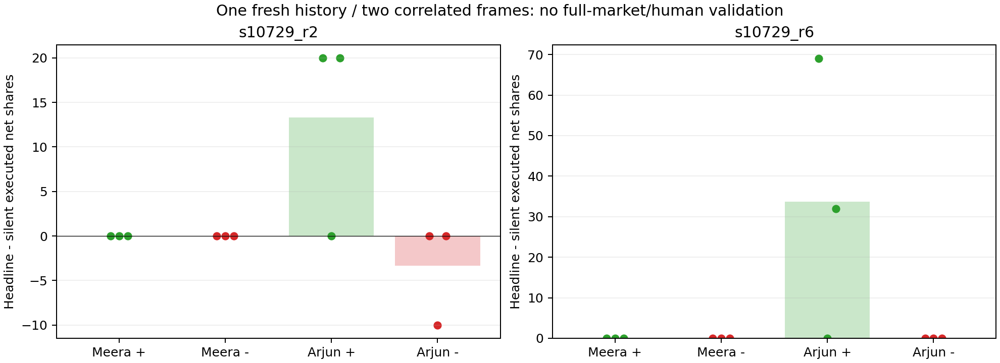

# R035: previously untouched source10729, linked independent-source gate

Phase status **completed_phase_schedule**; source completed1/1; conditional auctions settled18/18. Original planned study remains1/2 histories and18/36 auctions: failed9623 remains missing. No restart, substituted frame or historical-response reuse.

One fresh6-round quiet A history with predefined frames2/6, three fresh joint reply draws/headline. Same opening states/12 background tapes/captured RNG within frame, both focal actors treated together. Original Qwen8192/low/temp.3/common-hidden A variant. This is a single-history conditional one-auction pilot, not independent full-market replication or continuation of the old4096/shown-length query sample.

## Frozen headline-minus-silent executed signed shares

Three entries are fresh reply pairs on identical input states, not three independently generated market histories. Missing cells stay missing; no inferential/equivalence/general human/news-sign claim.

|Frame|News|Combined contrasts(3 draws)|Meera contrasts|Arjun contrasts|
|---|---|---|---|---|
|s9623_r2|positive|[None, None, None]|[None, None, None]|[None, None, None]|
|s9623_r2|negative|[None, None, None]|[None, None, None]|[None, None, None]|
|s9623_r6|positive|[None, None, None]|[None, None, None]|[None, None, None]|
|s9623_r6|negative|[None, None, None]|[None, None, None]|[None, None, None]|
|s10729_r2|positive|[20, 0, 20]|[0, 0, 0]|[20, 0, 20]|
|s10729_r2|negative|[0, -10, 0]|[0, 0, 0]|[0, -10, 0]|
|s10729_r6|positive|[69, 0, 32]|[0, 0, 0]|[69, 0, 32]|
|s10729_r6|negative|[0, 0, 0]|[0, 0, 0]|[0, 0, 0]|

Dots are fresh response-pair contrasts; bars only complete3-draw means. Both frames derive from ONE history.

## Economics, controls and accounting

Current hidden mean factors1/.8/1.2 are SAME-ORDER counterfactual settlements: draw source current dividend scaled by factor, private regime benchmark scaled, same auction RNG/orders/execution. They are not extra behavioural trials; information is unavailable at order cutoff. No claim about later learning, equilibrium price discovery, news accuracy or long-run profits.

Conditional F/M target-policy substitutions on identical source accounts/observations with specified original parameters, all3 headlines must give identical orders/fills. Equal current resources, not a full rule-population or intrinsic intelligence comparison.

All actual conditional orders/fills/quotes/prices/MM/counterpart accounts and BOTH one-auction stay-put marks are in report.json/queries/auctions.json. Missing partner choices are never settled. The auction-mark wealth difference is income/exposure accounting, not immediate trading skill; private benchmark marks are not executable prices.

## Delivery and scope

This phase:{'requests_made': 48, 'reserved_tokens': 702164, 'provider_reported_tokens': 124808, 'unknown_usage_requests': 0, 'blocked_requests': 0}. Including preserved R033 failures:{'requests_made': 50, 'reserved_tokens': 724448, 'provider_reported_tokens': 124808, 'unknown_usage_requests': 2, 'blocked_requests': 1}. Parent budget/failures/source files stay unchanged; only independent-source gating was amended. Backend/model sampling seed unavailable. No data/financial-sign selection or new default.

Unsettled delivered query choices:0. If source generation fails, no fresh frame or headline outcome exists. Failed9623's original18 auctions remain unattempted regardless of this phase's outcome.

Only ONE fresh source history, two correlated frames,3 reply draws/headline; not the completed two-history R033 or independent full-market repetitions. Joint conditional one-auction outcomes, not sequential feedback, lasting price discovery, trait/human validation or uniform news effect. Do not pool with R0344096/v2 shown-length retrospective replies. No new default/ABC/model switch.

No further seed/provider/recovery phase is automatic. Interpret outcomes and limitations before a new scientific design; do not retry until the expected sign appears.
