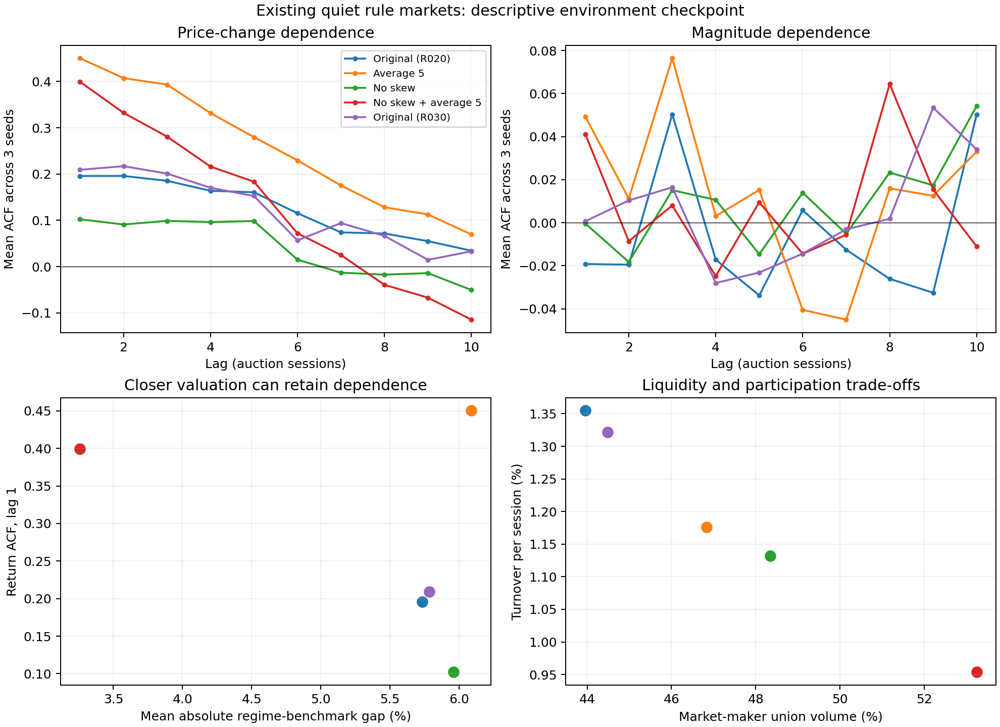

# Reference and environment checkpoint (R032)

Completed secondary analysis of 15 EXISTING 600-session rule paths. No new simulation/API call, changed default or empirical dataset. All original outputs/manifests verified; the12 R020 paths and3 fresh R030 paths remain separate cohorts.

## What the thesis can currently ask

1. Under specified laboratory-market rules, how do agent information/persona/policy affect intended orders, actual execution, exposure and market outcomes?
2. What do factual summaries/reflection explain, and what are their costs/limits, relative to the corrected simple condition?

These are controlled within-model questions. Passing accounting checks, low regime gaps or higher returns does not demonstrate human behaviour or external market realism.

## Reference map

[Kopanyi-Peuker & Weber (2024)](https://alexandria.unisg.ch/entities/publication/db4aabe2-939b-4008-b6d1-04cb0f16381e) varies market end-time assumptions and reports similar price dynamics. Only the primary published abstract/metadata was accessible here; no full-method replication is claimed. Our disclosure-only pilot differs from indefinite stochastic stopping and should not be expected to reproduce a selected human result.

[Ratliff-Crain et al. (arXiv v2,2024)](https://arxiv.org/html/2311.07738v2) examines Dow30 intraday data and finds support for8 of11 stylized facts, emphasizing asset/time construction. Use return/magnitude dependence as diagnostics, not a universal11-item checklist or numerical threshold for this tiny session-auction model. Full HTML reviewed; underlying dataset not obtained.

## Saved background evidence

|Setting (three seeds each)|Gap %|Return ACF1|Abs-return ACF1|Turnover %/session|MM volume %|MM boundary %|Cash growth %|
|---|---:|---:|---:|---:|---:|---:|---:|
|Original (R020)|5.73|0.196|-0.019|1.355|43.96|0.22|24.29|
|Average 5|6.09|0.450|0.049|1.176|46.83|3.17|24.29|
|No skew|5.96|0.102|-0.000|1.132|48.35|2.83|24.29|
|No skew + average 5|3.26|0.399|0.041|0.954|53.24|4.11|24.29|
|Original (R030)|5.78|0.209|0.001|1.322|44.49|0.89|24.30|

Five-payout averaging increases first-lag return dependence and reduces turnover in all six matched comparisons (two skew settings x3 shared seeds). Those six pairs are not six independent seeds. Removing skew changes gaps/activity without supplying an external realism target. A lower valuation gap alone cannot select the preferred environment.

Read all lag1-10 curves in report.json/figure; a single lag or short curve cannot validate or disprove long memory. Retain original skew.02/window1. This system accumulates cash from dividends/interest and redistributes holdings, so stationarity has not been established. Quiet rule paths do not establish that LLMs generate stylized facts;24-round live paths are especially inadequate for that claim.

## Next useful decisions

Keep the current environment as a declared laboratory and use the one bounded recording-length pilot alongside it. For the eventual leading behavioural/news result, choose at most ONE reasonable background sensitivity (e.g. inventory-skew removal) rather than selecting the lowest-gap setting. Preserve actual opportunity/intention/acceptance/fill, counterpart wealth and both passive marks. A news claim needs controlled message availability separately from economic change, or must be called a bundled-shock study. Downside opportunity and no-signal controls remain core work; A/B/C need not multiply each new question.

No human validation, universal component benefit, calibrated liquidity, inferential horizon effect, volatility-tail exponent or risk-adjusted model superiority follows. Reused data are evidence synthesis, not new confirmation.
