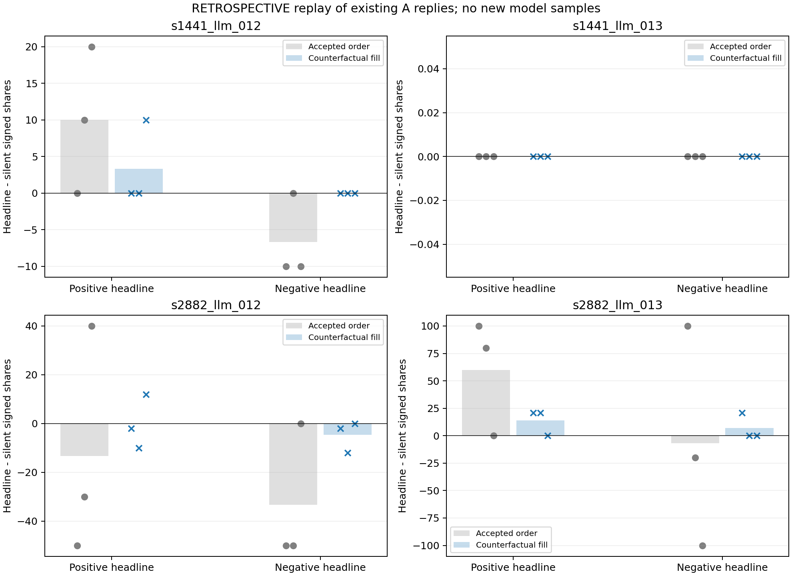

# R034: can the previously recorded news orders actually fill?

OFFLINE RETROSPECTIVE analysis of all36 existing A-only R025-R027 replies. **Zero new API calls or behavioural replies.** Same four reused agent frames/two markets and three original reply draws. Original Qwen4096/v2 shown-length prompts; separate from the unrun R0338192/common-hidden trials. Question chosen after observing old order contrasts, not independent prospective confirmation.

Each order replaces ONLY its focal trader's original round11 order. Other13 traders' actual orders, opening portfolios and original allocation RNG stay fixed. The other LLM cannot respond anew to the headline. These are conditional one-agent execution counterfactuals, not historical fills, joint public-news market effects or long-run equilibrium outcomes.

## Headline minus silent: all original draws

Signed shares: buy positive, sell negative. Reduced selling can be a positive contrast without a buy. An accepted contrast is a submitted demand change, not necessarily a fill. Price effects and counterparty fills can also change; no desired-sign pass rule.

|Frame|News|Accepted contrasts(3)|Counterfactual filled contrasts(3)|Mean accepted / filled|
|---|---|---|---|---|
|s1441_llm_012|positive|[0, 10, 20]|[0, 0, 10]|10.00 / 3.33|
|s1441_llm_012|negative|[-10, 0, -10]|[0, 0, 0]|-6.67 / 0.00|
|s1441_llm_013|positive|[0, 0, 0]|[0, 0, 0]|0.00 / 0.00|
|s1441_llm_013|negative|[0, 0, 0]|[0, 0, 0]|0.00 / 0.00|
|s2882_llm_012|positive|[-50, -30, 40]|[-2, -10, 12]|-13.33 / 0.00|
|s2882_llm_012|negative|[-50, -50, 0]|[-2, -12, 0]|-33.33 / -4.67|
|s2882_llm_013|positive|[100, 80, 0]|[21, 21, 0]|60.00 / 14.00|
|s2882_llm_013|negative|[100, -20, -100]|[21, 0, 0]|-6.67 / 7.00|

Dots are the three previously generated replies; bars their descriptive means. Four frames are correlated within two source markets. This does not add independent observations or justify inferential significance/human-bias claims.

## Economics, accounts and verification

Base dividend/private benchmark held fixed for headline comparisons. Three SAME-ORDER payout/mark variants1/.8/1.2 have identical price/trades; they are not new response draws or actual subsequent shock trajectories. One-auction stay-put holds opening shares/cash, earns the same current cashflows and uses the same terminal mark; normalization is opening market wealth, not the original-lifetime passive account. Both marks and ALL counterpart account outcomes are retained in report.json. Aggregate excess cancels at zero tax; no welfare, liquidation or risk-adjusted alpha follows.

Both original20-round source markets exactly replayed price-by-price/trade-by-trade. Original round11 accounts/auction, all36 raw replies/exact input messages and24 prior accepted contrasts reproduce. Current market/accounting/asset source hashes match the source snapshots. Original accepted orders stay unchanged except mapping experiment-specific IDs back to source account IDs. All36 canonical auctions/108 same-order settlements pass cash/share/finite-MM checks.

This extends interpretation of an existing query study with the missing execution mechanism. R033 still has no source/behavioural result: its failed source is not replaced here. Fresh-state headline/price confirmation, joint behavioural feedback and modest background robustness remain unverified. No production/default/A/B/C/model change or automatic extra experiment.
